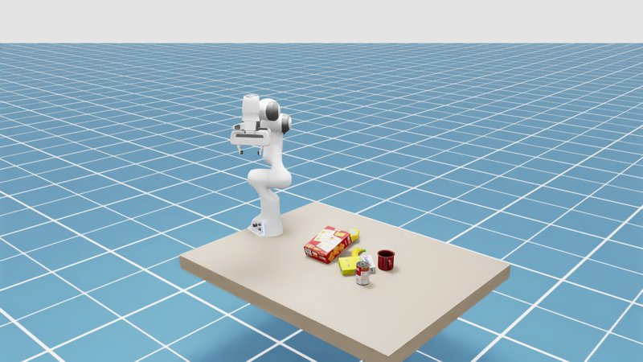
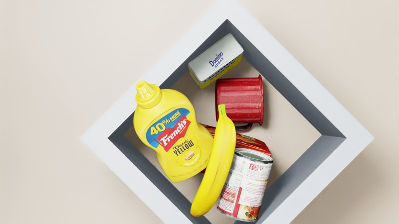

# GraspPushFlick / TRO-APFG

指定目标的三维杂乱环境取出研究：Active、Push、真实 Flip、6-DoF Grasp。已建立 M0 环境与资产基线，并按用户追加要求实现 SR5 硬件仿真和已知坐标动作接口，不训练模型或宣称最终算法贡献。

SR5 + PGIA-140-80-W + D435i 的装配、坐标运动与物理夹持/推动入口见 [硬件说明](docs/SR5_HARDWARE_ZH.md)，实际分项结果见 `evidence/sr5_hardware/summary.json`。真实 SR5/转接板保持源网格；PGIA/相机外形及外参为源快照近似。

**真实 GraspNet 6-DoF 推理和三维抓取位姿显示**使用独立入口，见 [GraspNet 说明](docs/SR5_GRASPNET_ZH.md) 与 `evidence/sr5_graspnet/summary.json`。此前的硬件 `--test grasp` 是已知坐标夹持测试，不能当作 GraspNet 感知抓取。

```bash
bash scripts/run_sr5_graspnet.sh --gui --preview-only --interactive --joint-speed .3
bash scripts/run_sr5_graspnet.sh --gui --interactive --joint-speed .3
```

```bash
bash scripts/run_sr5.sh --gui --test all --interactive
bash scripts/run_sr5.sh --headless --test move --xyz 0.45 0.04 0.32 --quat-xyzw 1 0 0 0
```

**APFG_M0_READY：RTX 3090 / Isaac Sim 4.5 替代组合的 M0 核心验收与 GitHub 同步均已通过。** 最新验收状态见 `evidence/m0_status.json` 和 [M0 报告](docs/M0_REPORT_ZH.md)。此前 CUDA/UVM 故障已在本次复查中恢复，项目没有升级或重载驱动。

实际验证组合：RTX 3090 24 GiB、Isaac Sim 4.5 二进制、Isaac Lab v2.0.2、Python 3.10.22、PyTorch 2.5.1/cu118。原定 5.1 pip 组合受本机 Ubuntu 20.04 / GLIBC 2.31 限制，不能把本轮结果称为 5.1 验证。

已准备 30 种官方 YCB，13 种完成独立物理验证。Franka 七轴/双指、固定和腕部 RGB-D、目标点云、S1 密集桌面与 S2 自然掉落围框堆叠均实际运行。GUI 和 Headless 共享代码；物理 120 Hz、视频 30 FPS，并核对 SDK 的真实步数与时间。GUI 场景使用默认 1280×720，部分 Headless 测试显式使用 640×480。

```bash
cd /data/GraspPushFlicks
bash scripts/run_gui.sh --test clutter --scene s1 --interactive
bash scripts/run_gui.sh --test clutter --scene s2 --interactive
bash scripts/run_gui.sh --test robot --interactive
bash scripts/run_headless.sh --test camera --offline
bash scripts/run_m0.sh
```

GUI 继承当前桌面的 DISPLAY/XAUTHORITY，支持原生旋转视角、相机选择、暂停和退出。S2 使用记录在案的真实静态围框，物体通过重力和接触形成堆叠；没有 rollout 中的物体状态重置。

所有安装、资产、缓存、完整视频与原始日志在项目内。`project_env.sh` 不修改父进程 HOME 或 .bashrc；Kit 使用 portable-root，仿真子进程使用独立 HOME。CUDA、GL 和 OptiX 缓存分别显式配置。内存 IPC、字符设备和线程命名操作与持久磁盘写入分开记录。

完整结果在 `outputs/environment_check/runs/<run_id>/`。便捷文件包括 `robot_motion.mp4`、`object_physics.mp4`、`clutter_preview.mp4`、`wrist_camera.mp4` 和 RGB-D 图片；原始运行文件不覆盖。完整视频仅保存在服务器，GitHub 提交代码、来源/哈希、精简指标和以下真实关键帧。




[环境](docs/ENVIRONMENT_SETUP_ZH.md) · [资产](docs/ASSET_MANIFEST_ZH.md) · [复现](docs/REPRODUCIBILITY.md) · [研究范围](docs/BASELINE_SCOPE_ZH.md)
