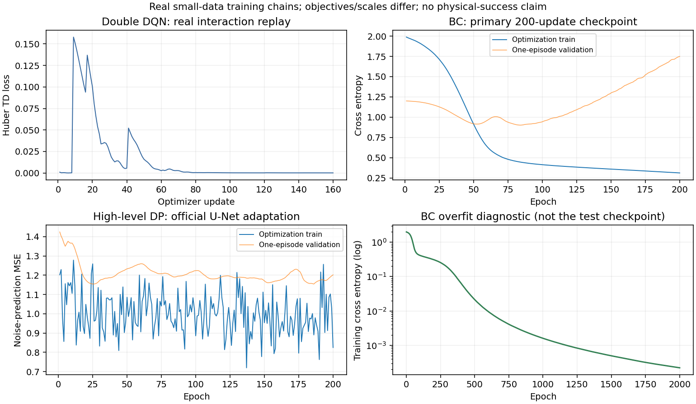

# Baseline 开发、真实训练与物理验证报告

本轮按 `com3.md` 和远端 `docs/BASELINE_PARALLEL_LAUNCH_2026-11-23.md` 实施。先fetch并快进合并专家提交 `08acc03`、`c0ddd7f`，保留M0/M1与所有既有实验；没有重装环境、重复下载资产、升级驱动或修改源机器人。训练/采集跨UTC 2026-11-23至24，具体时间以唯一运行ID与实际日志为准。

这是小规模工程链路和资格审查。E1初始16次没有显示准备动作的额外取出收益，示范数量与覆盖不足；**下一轮规模化训练NOT_READY**。不能把训练loss、少量候选匹配率或两例物理测试当作论文成功率、算法优越性或T-RO创新证据。

## 完成内容与身份

| 路线 | 实现/实际验证 | 证据边界 |
|---|---|---|
| 统一环境与候选接口 | PASS | `reset/observe/legal_actions/step/is_success/render`；真实RGB-D与物理运动；同一Isaac进程多episode重建，只在episode之间reset |
| Grasp Only / Heuristic / Random Valid | FROM_SCRATCH | 共同候选池下的三个独立非学习对照；随机对合法候选均匀采样，不能省略失败或无动作episode |
| DQN | FROM_SCRATCH 候选条件Double DQN | 4次真实online episode、6条实际转移、160次优化、8次target同步、Replay/optimizer/RNG/模型保存及实际加载检查 |
| BC | FROM_SCRATCH 候选分类 | 主模型200次真实优化；独立2000次过拟合诊断，不用后者替换主物理测评checkpoint |
| 高层DP | ADAPTED_OFFICIAL_NETWORK + 本地DDPM调度 | 真实成功数据加载、官方FiLM U-Net反传、32步去噪、checkpoint预测逐值复现；不是官方原生任务复现 |
| 原生DP / DP3 | NOT_RUN | 原生连续EE/夹爪动作chunk与高频同步点云示范尚未构建；不能把宏技能token适配叫作原版DP3 |
| GAPG/GOMP/MS-MEM/Uni-PNP/SPIN | NOT_RUN | 只完成一手来源、任务重合、软件/数据接口审查；没有把启发式替代品标成其论文结果 |

核心代码在 `apfg/baselines/`，统一接口与生成器分别为 `common_env.py`、`candidate_generator.py`，算法为 `heuristic.py/dqn.py/bc.py/dp_adapted.py`。配置在 `configs/baselines/`；训练/测评入口为 `scripts/train_baseline.sh`、`scripts/eval_baseline.sh`、`scripts/run_baseline_smoke.sh`。具体身份和实际状态见 [实现矩阵](BASELINE_IMPLEMENTATION_MATRIX.md)、[DQN公式及实现](DQN_BASELINE_ZH.md)、[BC/DP适配审计](IMITATION_BASELINES_ZH.md)、[强方法来源审查](BASELINE_SOURCE_AUDIT.md)。

官方DP网络固定于 `real-stanford/diffusion_policy@5ba07ac6661db573af695b419a7947ecb704690f`；仅复用三个小型网络源码文件，MIT LICENSE、原始/本地SHA与修改说明均保留。没有安装diffusers/Hydra/Zarr或下载训练数据/预训练DP权重。绘图复用了现有Isaac自带Matplotlib及其依赖，只在绘图子进程追加搜索路径，没有改动环境包。

## E1 v3 固定16次配对

新增 `configs/m1/e1_protocol_v3.json`，规范化内容哈希 `6d4c2c029288d07e948f90256bbab9065275be8bdb2826c0b8bcbaf870d37c19`，控制器源提交 `d51265bc76aab1d1cee45a16995a510d04f61a1b`，24份实现/配置/资产元数据哈希及GraspNet权重哈希在协议中。v1/v2原件没有覆盖。

固定首个seed `2026112201`、真实sugar box、四个family，各执行Direct/Push/Flip/View+Grasp，共16个episode。全部执行、全部记录，没有换种子或为了让某技能获胜而改布局。四组全部两两初态审计PASS：最大位置差0，最大姿态差约1.39e-17rad，低于2mm/.01rad门槛。每臂真实RGB-D输入哈希另存，图像随机舍入不被误当作物理初态变化。

| 实例 | Direct Grasp | Push→Grasp | Flip→Grasp | View→Grasp |
|---|---|---|---|---|
| Direct | PASS | FAILED | FAILED | PASS |
| C1 | PASS | FAILED | FAILED | FAILED |
| C2 | FAILED | FAILED | FAILED | FAILED |
| C3 | PASS | FAILED | FAILED | PASS |

共5/16完整取出，但**没有任何实例表现为Direct失败而准备后取出成功**。因此科学资格审查NO_GO，剩余48项NOT_RUN。配对执行流程PASS不代表机制资格PASS。C1、C3的Direct已成功，不能继续称它们分别“必须推”“必须观察”。

Flip在Direct/C1/C3的实际非yaw变化约94.84°/94.30°/94.84°，但后续均未完整取出；C2的Flip姿态变化约0°，未形成有效翻转。独立翻倒能力不能推出对原本躺平物体的重新定向能力。当前高位水平stroke能倾倒竖立盒子，却没有证明能把躺平盒子转到可抓状态。

原件：`outputs/baselines/campaigns/20261123T103731Z_f576e557/`。首个Direct等结果没有用旧M1 smoke或ORACLE翻转充数。

## 实际采集与真实训练

冻结前先做6次资产/进程复用探测：pudding两次无合法抓取（候选工具/桌面碰撞被拒绝）、cracker两次初态不稳定、mustard两次完整取出成功。探测数据没有偷偷变成正式E1或监督正例。由此在冻结前将小规模训练对象限定为真实mustard，明确只验证链路、不具备多物体多样性；没有修改原E1对象与测试seed。

12次预登记示范采集使用seed2320–2331（完整值2026112320–2026112331），保存成功6次、失败6次，共18条真实转移。成功示范仅8条转移：6个GRASP、2个ACTIVE；没有成功Push/Flip后完整取出的示范。来源包括Grasp Only、固定Active→Grasp、Heuristic、Random实际成功rollout，均有明确来源字段。完整关节/TCP/夹爪与接触轨迹、两路RGB-D/K/T、可见点云及三路MP4保留本地。

BC和DP读取同一个不可变清单 `outputs/baselines/dataset/demonstrations_v1.jsonl`，成功子集SHA256均为 `25dcd69a8c41c77bbf9978ba5550087994c2fa4d6835fff8d23faa8ea8f9e11a`。5个episode的6条转移用于优化，另1个完整episode的2条转移用于内部验证；它不是物理holdout。

| 实际训练 | 优化次数 | 首/末训练loss | 结果 |
|---|---|---|---|
| BC主模型 | 200 | CE 1.98831→0.31109 | 训练候选匹配5/6；内部验证1/2；加载预测差0 |
| BC独立过拟合诊断 | 2000 | CE 1.98831→0.000221 | 训练匹配6/6；内部验证仍1/2，不能解释成泛化 |
| 高层DP主模型 | 200 | 噪声MSE 1.20237→0.82507 | 真实32步去噪；训练候选匹配3/6、内部验证1/2；加载预测差0 |
| DQN online | 160 | 见实际TD曲线 | 4次真实交互，6条Replay，3次取出成功；训练时交错采样/更新，随后小Replay拟合；未由TD loss推导任务成功 |

DQN独立训练seed2332–2335，与12次示范无场景seed重复，Replay包含实际ACTIVE/PUSH/GRASP与失败。它没有用qualification或holdout标签训练。训练状态包含online/target、optimizer、Replay和RNG，实际加载后合法mask检查通过。BC/DP均为随机初始化，未借用旧糖盒成功来凑训练数据。

全训练交互16次有9次成功；BC/DP实际使用的成功示范仍只有6次，未把后续DQN样本暗中加进已冻结的监督集合。两者都不足十数条成功示范的初始数据门槛，也缺乏Push/Flip成功支持。当前结果只满足有限链路验证，不能归咎于DP/BC本身的能力，也不能继续大量生成只直接抓的示范来美化分数。



曲线来自原始CSV/JSON优化记录，四个面板目标函数不同、尺度不可横比。BC过拟合诊断checkpoint不用于主物理测试。网络均在CPU单线程小规模训练，GPU用于真实Isaac/GraspNet；真实反传不等于必须使用GPU。

## 同一物理holdout

原生GUI实际运行12次，含全部失败；同一场景六方法初始物体位姿完全一致，初始候选数组、candidate IDs与合法mask逐值相同。真实图像输入哈希各有6个，未伪造像素级相同：糖盒32维观测特征最大差约5.86e-5，汤罐为0；对应候选特征差均为0。详细配对/延迟审计在 `evidence/baselines/heldout_audit.json`。

| 方法 | 糖盒004 | 汤罐005 | 完整取出/实际尝试 |
|---|---|---|---|
| Grasp Only | PASS | FAILED：接近时跟踪误差 | 1/2 |
| Heuristic | PASS | FAILED：Push后无合法候选 | 1/2 |
| Random Valid | FAILED：Flip后无合法候选 | FAILED：接近时跟踪误差 | 0/2 |
| DQN | PASS | PASS：Active→Grasp | 2/2 |
| BC主模型 | PASS | FAILED：接近时跟踪误差 | 1/2 |
| 高层DP主模型 | FAILED：Active后无合法候选 | FAILED：Active后无合法候选 | 0/2 |

DQN汤罐实际选择了共同池中的左侧Active视点，随后真实取出。额外运动、8.57s仿真准备时间与后续推理均计账；这不能回填或推翻既定E1的NO_GO，也不能用两例证明DQN优越。DP的两个真实失败完整保留，不能由loss下降替代。各模型的实际 `act()` 平均耗时约：DQN0.468ms、BC0.525ms、DP26.62ms；三种非学习选择器约0.074–0.098ms，另计共同GraspNet/路径规划时间。

物理holdout原件：`outputs/baselines/campaigns/20261124T025638Z_c38f8690/`；开始前写入测试顺序、模型哈希与执行脚本SHA的 `heldout_preregistration.json`，事后检查脚本未变化。全部由脚本自动运行，无手工点击或动作替换。

训练对象是mustard006；六方法统一测试两个固定Direct场景：sugar004/seed2026112309、soup005/seed2026112310。与训练对象/seed互斥，资格审查记录不用于学习。这里的heldout仅指高层基线训练分区，不能宣称这些YCB物体对原有GraspNet预训练也是未见。GUI模式、传感器、候选池、预算、完整取出门槛和机器人控制均相同；每个决策真实刷新RGB-D。策略仅接收32维共同传感几何/本体特征、24×24候选特征和mask，没有family/seed/物体真值或资产ID输入。

候选上限24是padding容量，当前实际最多11个候选；原始GraspNet最多检查8个、每个最多2个手指交换分支，每步只向策略暴露第一个已检查可行抓取。Active两视点，Push/Flip各四方向。策略均在这个相同支持上选择，不强行填入无合法动作；DQN是Q(o,candidate)，而非把变化的数组槽位冒充固定物理动作。

完整成功仍要求整物源外接几何越过任务区y=.30m、相对初态升高>.10m、双指真实目标接触持续1秒、无严重干扰物掉落；不是单纯抬高。每次episode最多1个准备动作、1次抓取，没有额外免费的相机复位。Oracle只用于私有物理评价/奖励，不送入模型；poison-oracle与数值字段白名单测试覆盖该边界。

## 失败分析与下一步门槛

1. E1四次动作后GraspNet返回 `NETWORK_RETURNED_NO_GRASPS`；其他失败含候选被源工具/桌面/整臂路径检查拒绝、C1观察后夹持未完整取出。它们不是CUDA故障，也没有用预设抓取替代网络空输出。
2. C2准备动作未产生有效重新定向，任务无解不能简单归因于高层策略。Push有时也导致倾倒，其机械作用与当前Flip重叠。
3. mustard/soup使用显式初始工作区提示，糖盒使用可见颜色提示。动作后物体移动/遮挡可使目标关联失效；固定初始ROI不是目标跟踪器。它没有GT泄漏，但限制了Push/Flip后的识别与候选生成。
4. 汤罐部分抓取在 `grasp_approach` 提前发生左指/目标接触，关节跟踪误差.034531rad超过原.025rad阈值。保留失败，不靠提高马达力或放宽阈值越过接触。
5. 数据只有一个训练物体、少量成功动作/序列，内部验证与训练拟合分离；少数holdout结果不支持算法能力排序。

因此下一轮大训练 **NOT_READY**。先做物理原语/动作后目标关联和C1/C2/C3机制资格修正，另存新协议再对照；需要真正Push/Flip→完整取出的异质示范和足量同步轨迹，再考虑原生DP/DP3与规模化训练。当前不开发Ours、不执行E2/E3、不宣称形式化贡献。

## 复现、资源与存储

本轮合计50个真实初始化episode尝试（包含6个探测、16个E1、12个采集、4个online、12个GUI测评），其中5次没有执行被选中的宏动作，仍计入失败/资源分母。全体包含57条宏动作转移；正式数据ledger为44个非probe episode、55条真实转移，全部55条哈希/shape/mask/RGB-D/轨迹审计PASS。原始episode目录合计约3.13GiB；设备总显存1Hz采样最高5474MiB（约5.35GiB）。按全部episode包含reset的实测walltime合计约3773.3s、仿真时间1710.4s，约54.4条转移/墙钟小时、217.6个真实物理步/墙钟秒；不包含排队和额度中断的空闲时间。69项CPU回归测试PASS；额外证据聚合3项检查PASS。

保持RTX3090 / 驱动535.230.02 / IsaacSim4.5二进制 / Lab v2.0.2 / Python3.10.22 / torch2.5.1+cu118。CPU PhysX MBP/TGS480Hz、RTX RGB-D640×480、30fps三路真实录制。默认一个Isaac/CUDA负载持有项目GPU锁；offline CPU训练可以并行，未并发塞满3090。每episode实测walltime、仿真时间、动作/推理/规划耗时、数据量在证据中；1Hz显存峰值为设备总量采样（含桌面和GraspNet子进程），不是精确allocator峰值。排队时间不冒充仿真吞吐量。

```bash
# 已完成的E1 v3和采集/online重现入口，会创建新目录，不覆盖原件
bash scripts/run_baseline_smoke.sh --headless --mode e1
bash scripts/run_baseline_smoke.sh --headless --mode collect --episodes 12
bash scripts/run_baseline_smoke.sh --headless --mode online --episodes 4
source scripts/project_env.sh
"$APFG_PYTHON" scripts/train_imitation.py --method bc --manifest outputs/baselines/dataset/demonstrations_v1.jsonl --output outputs/baselines/train/bc_REPRO_NEW --epochs 200 --device cpu --threads 1
"$APFG_PYTHON" scripts/train_imitation.py --method dp --manifest outputs/baselines/dataset/demonstrations_v1.jsonl --output outputs/baselines/train/dp_REPRO_NEW --epochs 200 --device cpu --threads 1
bash scripts/eval_baseline.sh all --gui --dqn-checkpoint outputs/baselines/campaigns/20261124T025108Z_ab7cad4b/dqn_online.pt --bc-checkpoint outputs/baselines/train/bc_demo_v1/model.pt --dp-checkpoint outputs/baselines/train/dp_demo_v1/model.pt
```

完整数据、Replay、权重与MP4在 `outputs/baselines/`，仅服务器本地。GitHub仅提交核心源码/配置/报告、实际loss CSV、精简指标、真实关键帧与相对路径/SHA清单，不把本地大视频称作远程可下载。[轻量证据](../evidence/baselines/summary.json)、[数据审计](../evidence/baselines/dataset_audit.json)、[源码身份矩阵](BASELINE_IMPLEMENTATION_MATRIX.md)给出逐方法/场景/失败及数据来源。
