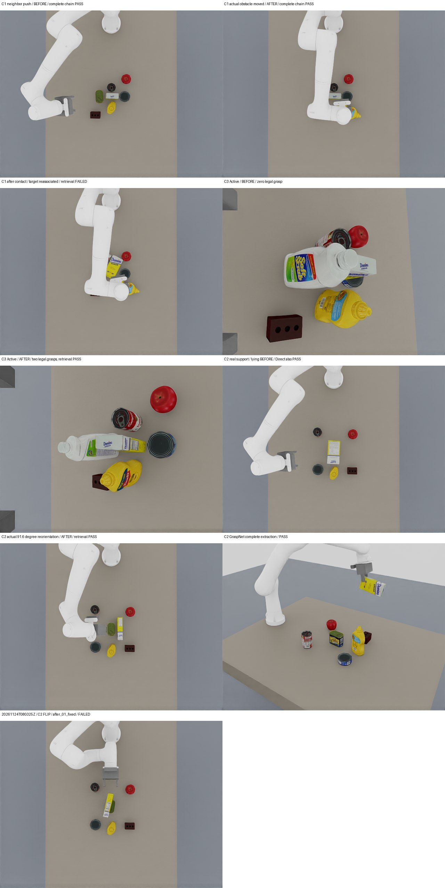

# 局部密集场景、动作后关联与共同候选 v2 实测报告

本轮先fetch并快进至专家审查提交 `53b72c0`，完整阅读 `BASELINE_SCENE_AND_POSTACTION_ASSOCIATION_REVIEW_2026-11-24.md`，在原RTX3090 / Isaac4.5 / Lab2.0.2环境增量实施。没有重装、下载资产、启动DQN/BC/DP训练或删除旧数据。E1 v1/v2/v3、Baseline训练权重/数据及E1 v3的24份冻结源码均保持不变。

这是有限开发诊断，**没有把迭代试验重标为正式E1，也没有通过挑选胜例宣称算法优越性**。每次启动前保存有序任务、场景、源文件SHA及完整源快照；失败、无合法动作、身份切换和取消的排队任务均保留。v4开发索引是这些注册的汇总，不是事后伪装的统一预注册。

## 代码与版本

| 接口 | 位置及实际变化 |
|---|---|
| 场景 | `apfg/scenes/clutter_v2.py`、`configs/scenes/v2/`；`clutter_scene_v2`，最终generator revision 5；Direct/C1/C2/C3/Mixed均7件真实本地YCB，围绕目标放置近邻，开放桌面，不增加虚构挡板 |
| 仿真 | `clutter_hardware.py`复制冻结v1初始化以切换验证器/近距离第三视角，其物理tick、相机、录制、关闭仍继承原实现；`clutter_env.py`共享GUI/headless流程 |
| 感知 | `apfg/perception/target_association.py`；`rgbd_temporal_association_v2`最终implementation revision 6，输入仅实际RGB-D/K/T、本体和初始任务ROI |
| 候选 | `apfg/baselines/candidate_generator_v2.py`；`baseline_candidate_v2_noncompatible`，32槽上限；实际有最多3个已检查Grasp、6个目标相对环视点、4个可见近邻的双方向Push、4个目标Push及多种Flip试探 |
| 运动 | `preparation_v2.py`支持原侧推倾倒、倾斜指端上挑；`pinch_reorientation.py`另外实现真实夹持/滚转/放回/释放，源检查在释放处停止运输目标云；状态以实际记录为准 |
| 执行/证据 | `scripts/run_clutter_v2.sh`、`audit_clutter_v2.py`、`collect_clutter_v2_evidence.py`、`play_clutter_v2.sh` |

两个候选schema不兼容：本轮没有硬加载旧32维特征DQN/BC/DP模型，也没有输出zero-shot性能。GraspNet原权重和原始6D预测保持不变，候选关联增加了实测目标表面/空间范围检查。最多检查12个原始关联候选、各2个手指交换执行分支，暴露最多3个完整装配路径通过的抓取。不存在手工补写GraspNet预测或oracle抓取后备。

目标初始ROI只用于建立外观与形状参考。之后通过三维表面连通、HSV外观、形状特征、相对运动和上一时刻可见表面重叠进行多假设关联。Active优先采用静态表面重叠，接触动作允许未知位移/重定向；已知控制命令只能预测搜索中心，不能直接生成mask。可见悬边的几何分层用于区分窄的下层支撑；它是有失败风险的工程启发式，不是通用完美实例分割。LOST/UNCERTAIN保持显式，不使用旧ROI兜底。物体ID、PhysX位姿和实例分割仅进入单独评价，不进入mask、候选或策略输入。

## 主要真实结果

**局部密集场景PASS（开发层）。** 每个新场景7件，C1/C3落定后各有4个非目标与目标的源AABB距离小于4cm；更完整的逐物体距离、真实接触和稳定性见证据。AABB距离是复杂度代理，不冒充精确网格距离或实际接触。C2真实支撑场景的近接触统计单列，不能假定每个family都同等密集。Mixed仅完成稳定性/生成检查，不称多技能任务已解决。

**真实推障碍PASS，完整链路有成功也有失败。**
- `20261124T071346Z_b9d9420f/episode_001`：推动可观测近邻芥末瓶，真实接触、水平位移约12.8cm，随后糖盒完整取出。`20261124T071919Z_ba015e2e/episode_005`也完整取出。
- 后续完整目标云改变了接触点/轨迹检查；`20261124T072632Z_124bc8c8/episode_005`将芥末瓶水平移动约13.0cm，并连带撞倒糖盒。静态重叠假设导致TARGET_LOST，保留失败。
- 接触运动模型修复后，`20261124T074245Z_a709c87e/episode_002`在同一物理动作后保持目标关联；固定mask精度1.0、召回约0.698，腕部精度约0.933、召回约0.742。后续没有合法抓取，**任务仍FAILED**；不是把重新找到目标算作取出成功。
- 这些C1实例的Direct也能成功，不能标为“必须推动”的合格因果样本。

**Active→Grasp PASS，出现单实例有效准备收益。**
`20261124T072632Z_124bc8c8/episode_002–003`为同实例Direct/Active对照：Direct无合法抓取；Active真实移动腕部相机后，固定+腕部融合的目标5mm可见体素由463增至701，新增375个体素，合法抓取从0增至2，随后完整取出。两路mask前后精度均1.0。固定相机仍看见目标顶部，不能称“整个目标初始完全不可见”；新视角补充了表面与可执行抓取信息，衡量的是完整双相机系统。物体运动与Active耗时另有实测。后续revision 5、6再次实际完成此链路，但仍是同一个开发seed，不是多seed统计收益。腕部运动也改变了起始关节姿态/规划可行性，不能由这组对照独立归因于纯信息收益。

**卧倒→非yaw翻转→Grasp PASS；Flip必要性未通过。**
`20261124T075922Z_9e0cf087/episode_001`采用真实potted meat can支撑和可见悬边，源指端上挑使糖盒产生 **91.599°** 重力/支撑方向变化，实际接触、机器人释放、桌面新支撑与稳定性均PASS。随后重新获取RGB-D、运行真实GraspNet，2个合法抓取候选，最终完整取出PASS。翻转后固定/腕部mask精度均1.0，召回约0.991/0.994。未设置目标位姿或添加抓取约束。其Direct对照 `episode_000`也PASS，因此它证明原语链路可行，**不证明Flip必要或有取出收益**。

早期C2的上挑虽真实接触，最终非yaw变化仅约0.068°或0.733°，均FAILED；被挡住/不可达的候选也保留。没有用竖盒倾倒代替卧倒物体的翻转证据。早期围绕世界轴原地转动的夹持方案出现IK不可达；改为源第6关节的可达轴向滚转，并区分释放前后云运输，`20261124T080325Z_8b3f1892/episode_000`真实执行夹持/第6轴滚转/放回/释放，实际非yaw变化88.692°、释放/稳定/关联PASS，mask两路精度均1.0，但后续没有合法抓取，整任务FAILED。源自真实接触与摩擦，不是附着约束。默认 `--flip-mode any` 允许该候选优先；展示已成功的上挑链路应显式指定 `--flip-mode edge_lift`。不能由离线源检查PASS推断物理成功。

## 数据审计和边界

共25次真实GUI episode尝试，含9次没有被选中的宏动作；10次完整取出（混合开发任务，不能算算法成功率），80项CPU回归测试；原始失败和无宏动作episode均保留。只有一个在GPU锁外取消的排队注册，物理episode为0，单列NOT_RUN。独立源码/RGBD/轨迹/录像审计及所有25次实际初始视角后的1秒稳定性窗口均PASS；不能将这些完整性PASS当作25次任务全成功。

出版前仅给入口增加显式 `--flip-mode` 过滤和初始相机运动后的稳定性门槛。所有旧运行源快照保留；已有25次同一稳定性门槛事后独立审计全部PASS。此入口加固没有重新标注实验或宣称重新运行过全部25次。


完整结果、每条失败、版本、候选数、费用与同实例初态对照：[summary.json](../evidence/clutter_v2/summary.json)。数据/源快照/录制及落定后稳定性审计：[data_audit.json](../evidence/clutter_v2/data_audit.json)。原始大文件的相对路径/字节数/SHA：[artifact_manifest.json](../evidence/clutter_v2/artifact_manifest.json)。这些是服务器本地文件清单，**不是GitHub视频下载地址**。

实际GUI录像三路均640×480/30fps，保存真实RGB-D、K/T、mask、目标点云、原始GraspNet、已检查计划、机器人/物体轨迹、实际接触、时间和所有失败。初态比较是全体物体实测位姿，2mm/.01rad门槛保持不变。GT mask只在评价计算precision/recall和融合可见体素，绝不用来回填追踪。质心到body原点误差是可见表面代理，不能当作完整物体6D位姿误差。

本轮CPU PhysX/RTX渲染配置与物理步长480Hz未变。逐动作wall/simulation时间和episode总wall均记录；感知/候选规划耗时计入总wall，当前没有全部独立拆分，不能据此作算法耗时排名。小样本与单一指定目标不足以评价通用重识别、技能最优性或T-RO贡献。



数据目录约1.857GiB，实测episode wall合计2781.9s（含初始化/规划，不含GPU排队与人工开发时间）。25次均通过录像和数据完整性审计。额外夹持滚转中，真实双指/目标接触719帧，其中实际滚转阶段312帧；释放后独立稳定评价通过，后续抓取仍失败。D435i/PGIA几何和外参继续沿用已披露的APPROX模型，未冒称厂家完整CAD或实机标定。

开发注册汇总及未来正式协议边界见 `configs/m1/e1_protocol_v4_development.json`。它没有覆盖旧E1，也不把本轮迭代变成同一冻结主表。

## 查看与复现

```bash
# 不启动Isaac，直接查看实际录像；自动提供已验证的VP8播放副本
bash scripts/play_clutter_v2.sh --list
bash scripts/play_clutter_v2.sh active
bash scripts/play_clutter_v2.sh flip --run-id 20261124T075922Z_9e0cf087 --camera fixed
bash scripts/play_clutter_v2.sh push
# 有限GUI验证；每次生成唯一新目录，不覆盖既有实验
bash scripts/run_clutter_v2.sh --gui --flip-mode edge_lift --cases C1:PUSH,C2:FLIP,C3:ACTIVE
# 同一程序也支持 --headless；本轮物理证据为GUI，未冒称本轮独立headless验收
```

所有原件在 `outputs/clutter_v2/campaigns/<run_id>/`，各次 `development_preregistration.json` 和 `source_snapshot/`记录实际执行代码。最终代码与早期迭代不同，复核旧记录应使用其源快照，不能默认为所有结果来自同一冻结版本。

**下一轮规模化训练NOT_READY。** Active有单例准备收益；C1尚未构成必须移障的任务，C2成功翻转实例的Direct也成功。应在另存且事前冻结的正式v4协议中先解决这些机制资格问题，保留失败并收集异质的真实成功序列，再考虑训练扩量；本轮不启动Ours、E2/E3或大规模学习。
