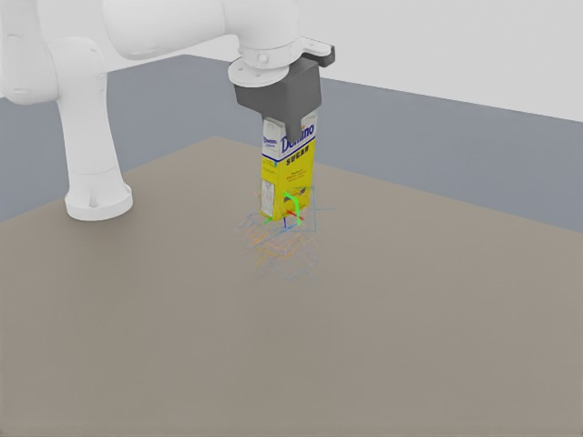

# 抓取前额外转腕修正与实测（2026-11-23）

用户观察到抓取前末端先转约180°。真实遥测确认该现象：M1原轨迹在hover阶段TCP净转178.35°，第六轴实际走210.70°；独立GUI入口净转170.20°。本轮修正执行姿态选择和角度连续性，复用现有环境、源装配和GraspNet，无安装、训练或新推抓算法。

## 原因与修正

平行双指抓取中，绕接近轴交换左右手指可得到相同的夹持轴线，但原选择直接采用网络输出的一个有向表示，未考虑当前腕部朝向。旧IK又直接返回优化器的关节角表示，可能在源限位允许时走较远的2π等价角。例如从约+45.7°去−165°，另一等价表示+195°的关节路程更短。单独消除2π绕行不能消除原始抓取有向姿态的近180°差异，因此两处分别处理。

`SR5Model.ik()`只在源URDF关节限位内选择靠近当前关节的2π等价表示，目标物理位姿不变。显式给定的 `move_tcp`/关节控制不会自动改成其他物理抓取姿态。

`apfg/primitives/grasp_motion.py`保留原始候选、score、raw_row和TCP映射四元数，另存 `execution_pose`。对每个原始候选，考虑原朝向及绕TCP +Z接近轴交换手指的两个执行分支，优先尝试从当前姿态旋转较小的分支。交换手指保留TCP位置和接近轴；它是选择等价抓法，不是在动作开始时额外下发一次180°旋转指令。

相机、转接板与完整末端不具备这个对称性。因此每个分支分别检查源工具/桌面/实测点云、IK和整臂/携带可见目标的扫掠路径，未通过就拒绝，不强制套用“最近朝向”。保持原始候选分数顺序、最多8个原始候选，每个最多2个执行分支，7个采样/实际关节段；没有逐帧额外安全预检、影子物理、物体重置或抓取约束。

规划包含实际将执行的hover、pre、5段approach、lift，以及M1的extract。执行复用同一组已检查关节目标，不在动作开始后重新求解另一条IK分支；实际关节/TCP最终误差仍正常检查。起点关节变化超过.025rad会拒绝过期计划。自定义接近/提升/取出参数与缓存计划不同，必须重新做一次有界检查。

绿色抓取图形和轴显示执行姿态，其他候选保留原始预测；独立GUI同时显示原始/执行四元数与手指交换标记。原始 `candidates.json`、网络预测NPZ与 `selected_candidate` 不被改写，执行映射见 `grasp_plan` / `execution_plan.json` / 实际commands。两条入口共享该控制实现。

## 实测结果

对照指标由实际PhysX关节/末端姿态计算，取hover运动开始前一帧至该阶段最后一帧，包含阶段末保持；不是仅比较指令四元数。两组前后选中的原始网络预测值分别完全一致，没有用换网络候选掩盖问题。

| 指标 | M1原轨迹→修正后 | 独立GUI原轨迹→修正后 |
|---|---|---|
| 原始预测index | 172→172，raw_row完全一致 | 143→143，raw_row完全一致 |
| TCP净姿态调整 | 178.35°→61.12° | 170.20°→21.75° |
| TCP累计实际转角 | 194.72°→64.57° | 170.89°→22.15° |
| 第六轴实际角路程 | 210.70°→30.71° | 154.35°→25.65° |
| hover实际阶段时长 | 18.80s→6.47s | 13.90s→3.57s |
| 新运行物理结果 | PASS：整物取出、双指真实接触30/30帧、保持1秒 | PASS：持续提升149.26mm、双指真实接触30/30帧 |

Headless M1新运行：`outputs/m1/runs/20261123T093925Z_15da3e12/`，命令 `bash scripts/run_m1.sh --headless --family Direct --action grasp`；原对照 `20261122T095317Z_45c90433`。

GUI新运行：`outputs/sr5_graspnet/20261123T094048Z_b931a835/`，命令 `bash scripts/run_sr5_graspnet.sh --gui --joint-speed .3`；原对照 `20261122T084930Z_e8d15d13`。独立GUI只验夹持/提升，不能将它称为完整任务取出；完整取出由M1运行单独验证。

三路MP4均使用真实渲染帧并通过内容/黑帧/帧数校验。已生成两个新运行的第三人称与腕部VP8/WebM兼容播放副本，原MP4不变。原始报告、全部早期失败和冻结E1 v1/v2均保留。当前33项CPU回归测试PASS，覆盖2π限位、原预测不可变/接近轴不变、相机非对称碰撞、执行复用已检查关节和过期计划拒绝。

## 查看与复现

```bash
# 查看修正后GUI近景录像，无需重新启动Isaac
bash scripts/play_video.sh outputs/sr5_graspnet/20261123T094048Z_b931a835/videos/graspnet_6d/third.mp4
# 查看修正后的M1完整取出
bash scripts/play_video.sh outputs/m1/runs/20261123T093925Z_15da3e12/videos/m1/third.mp4
# 重新实际运行
bash scripts/run_sr5_graspnet.sh --gui --joint-speed .3 --interactive
bash scripts/run_m1.sh --gui --family Direct --action grasp --interactive
# 回归与精简证据重建
source scripts/project_env.sh
"$APFG_PYTHON" -m unittest discover -s tests -v
"$APFG_PYTHON" scripts/collect_grasp_motion_evidence.py --m1-run outputs/m1/runs/20261123T093925Z_15da3e12 --gui-run outputs/sr5_graspnet/20261123T094048Z_b931a835
```

精简结果与原件SHA256清单：`evidence/grasp_motion/summary.json`、`artifact_manifest.json`。源装配仍为同一URDF；运行栈仍是RTX3090、Sim4.5/Lab v2.0.2、CPU PhysX480Hz、RTX RGB-D640×480/30fps。

必要的六维抓取姿态调整仍然保留：侧向抓取并不保证零旋转；若较近分支因相机/转接板碰撞而不可行，允许拒绝或使用经过检查的另一分支。新控制版本为 `parallel_jaw_execution_v1`，正式比较前应显式冻结包含该版本/分支预算的协议，不能把它的结果混入原E1 v2假定的控制实现。本轮仅为控制回归，E1/E2/E3、训练和机制必要性比较均NOT_RUN。


