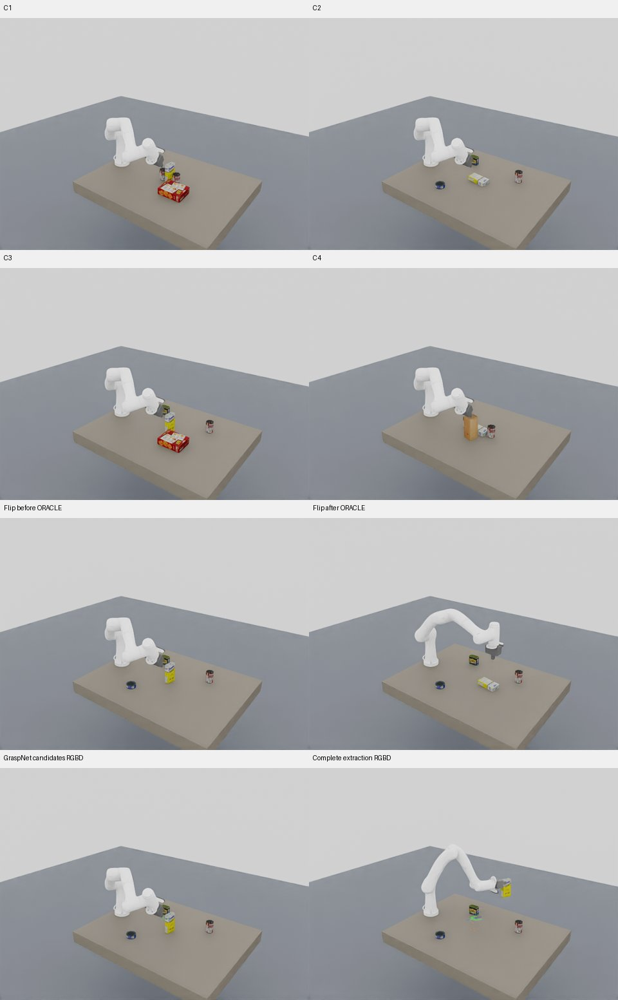

# M1 实测报告（2026-11-22 UTC）

本轮按 `com2.md` 实现并实际运行 M1：四类候选场景、C4 混合配置、统一观测/动作接口和少量开发 smoke。没有重新安装环境、下载已有资产、训练网络或执行 E2/E3。先 fetch 并快进合并远端专家蓝图提交 `9a04124`，保留既有 M0、硬件及 GraspNet 证据。

本报告对应 `evidence/m1/summary.json` 的全部 17 次开发运行，含 4 次失败；不是正式 E1 的 64 个比较实验，不能计算论文成功率或声称机制必要性。完整原件在服务器项目内 `outputs/m1/runs/<run_id>/`，GitHub 仅含精简指标、相对路径/哈希与真实关键帧。

## 实测分项

以下均为种子 `2026112201`、目标真实 YCB sugar box。PASS 只表示表中门槛通过。

| 内容 | 状态 | 运行 ID / 实际结果 |
|---|---|---|
| Direct 生成与稳定 | PASS | `20261122T094344Z_017251c5`；四个真实几何刚体 |
| C1 空间不足候选布局 | PASS | `20261122T094514Z_639cae5e`；初始左右 AABB 间隙 7mm；落定后真实位姿另存 |
| C2 不利姿态候选布局 | PASS | `20261122T094547Z_5578e311`；目标初始绕 Y 旋转 90° |
| C3 信息不足候选布局 | PASS | `20261122T095447Z_aa41cca7`；真实遮挡物与相同初始腕部视角 |
| C4 混合配置与稳定 | PASS | `20261122T095446Z_81d1e0be`；仅检查布局，不执行 E3 |
| Active，相机实际运动 | PASS | `20261122T095447Z_aa41cca7`，Headless / RGBD_POLICY；相机实际平移约480mm，物体位移 0，图像与外参变化 |
| Push，真实接触位移 | PASS | `20261122T095141Z_33fd0fc3`，Headless / RGBD_POLICY；目标位移约 `[163.68,-0.94,-66.17]`mm；同时发生倾倒 |
| Flip，非 yaw 新稳定支撑 | PASS | `20261122T095316Z_b417c953`，GUI / ORACLE_DIAGNOSTIC；非 yaw 94.835°，水平旋转向量分量 94.841°；机器人撤离、目标接触桌面，局部主支撑轴 Z+→X− |
| Grasp，GraspNet 完整取出 | PASS | `20261122T095317Z_45c90433`，Headless / RGBD_POLICY；真实预测 index 172，整物越过任务区 y=.30m、升高 >.10m，双指真实目标接触持续 30/30 帧、1秒 |
| 原生 GUI 场景与录像 | PASS | `20261122T094653Z_20726c4f` C1 交互查看；上述 GUI Flip 自动完成 |
| 三路录像解码与时序 | PASS | 每次运行第三人称、固定、腕部 RGB 原始 MP4；逐视频完整解码统计，真实时间戳存档 |
| CPU 回归测试 | PASS | 25 项 unittest；含显式真值隔离、纯 yaw 拒绝、哈希篡改拒绝及既有 SR5 接口测试 |
| Active 的信息收益/抓取收益 | NOT_RUN | 新版可见提示像素 wrist 8144→4012，不能解释成信息改善；没有正式 View+Grasp 对照 |
| C1/C2/C3 机制必要性资格审查 | NOT_RUN | 尚未做同实例 Direct / Push / Flip / View + Grasp 完整对照 |
| C2 Flip→Grasp 完整取出 | NOT_RUN | 本轮只验证独立翻转；不能由 Direct 翻转 smoke 推断 C2 已解决 |
| E1 正式比较、E2、E3、训练 | NOT_RUN | E1 v2 协议已冻结；本轮没有这些实验结果 |

没有待安装依赖或当前外部阻塞项；后续尚未验证的任务明确标为 NOT_RUN。

## 全部失败与修订

| 运行 ID | 状态 | 观测与处理 |
|---|---|---|
| `20261122T094513Z_fd54dd26` | FAILED | Direct 抓取 pre 阶段实际关节跟踪误差 .049265rad；link4 撞到腕部视野外的 tuna。保留同一物体布局，融合已有固定与腕部真实点云后，完整机械臂检查拒绝该候选并选取另一条原始 GraspNet 候选。后续 `20261122T094819Z_98ffa3f4` 完整取出 PASS，最终修订再次 PASS。 |
| `20261122T094820Z_f3ab3300` | FAILED | 推动接近关节误差 .191515rad；真实夹爪壳体向前伸出 57.5mm，原预接触退距52mm不足。修正为80mm并用四段实际下降；没有关闭碰撞或移除末端零件。 |
| `20261122T094641Z_0f51ef8f` | FAILED | C4 cracker 前遮挡物末段转动 .0245rad，超过 .01rad 稳定门槛。 |
| `20261122T095140Z_81ce7675` | FAILED | C4 延长自然落定后仍晃动。未放宽门槛；仅修改 C4 前遮挡物为真实 YCB wood block 后重新生成并实际落定 PASS。旧配置/影片完整保留。wood block 不适合当80mm夹爪目标，本轮仅作为障碍物。 |

早期 Active 使用较宽黄色阈值，会把红橙 cracker 局部算入提示；v2 增加显式 R/G 范围 .75–1.35，保留 v1 配置/记录，不把旧提示像素变化称为识别收益。E1 v1 冻结文件未覆盖，v2 显式记录修订原因，数值物理结果门槛不变。早期开发源代码的临时中间版本未单独提交；其配置、指令、原始遥测与结果可审计，最终提交代码包含修复，不声称逐字恢复早期程序。

## 实现与信息边界

`apfg/scenes/m1.py` 生成有种子、XY/姿态扰动、AABB/尺度筛查、真实资产哈希及内容哈希的场景；`configs/m1/target_suitability.json` 对8个目标给出 CONDITIONAL 筛查，未把最小外接尺寸合适等同于所有姿态都可抓。质量/惯量/摩擦/COM 继续引用原注册表估计来源。

`M1Environment.observe()/step(Action)` 复用 `HardwareScene`、六轴控制器、80mm夹爪与实际 GraspNet，返回统一 `StepResult(observation, terminal, cost, diagnostics)`。Active 使用相机视点/注视点；Push 使用接触点、方向、距离、名义速度；Flip 使用接触点、水平主导转轴、行程、速度；Grasp 使用原始预测转换后的位姿、接近距离、提升量、取出位置。速度通过分段关节轨迹时长控制，仍受真实关节驱动/接触影响，不是经过标定的末端力控制。CLI 中 action 是用户指定的基线，不是由 family 标签推断的决策策略。

RGBD_POLICY 仅返回两路 RGB-D、标定/外参、关节/TCP 本体感知、显式任务提示、候选和动作历史。黄色可见提示或明确任务区域是传给感知的任务输入；没有读取实例分割、真实物体位姿来做目标掩膜。测得表面连通分量用于扩展提示，接触物体可能被合并，尚非通用目标实例识别系统。RGBD 抓取必须使用登记的实际网络候选，不能偷偷替换为已知物体坐标。

ORACLE_DIAGNOSTIC 必须显式指定；本轮 Flip 的接触点由真实物体位姿诊断生成，其结果仅证明运动/接触能力，不能称为 RGBD 翻转策略。真实位姿、接触、稳定支撑、干扰物移动/掉落存入独立 `evaluation_oracle.json`、`telemetry.json`、`contacts.json`。评估器读取真值不代表真值送入 RGBD 策略；毒化 oracle 回调测试确保 RGBD 构造过程不访问它。

抓取选择执行一次有界的源 URDF 全臂凸碰撞形状、已知桌面、实测双视点云与携带可见目标点云检查；最多检查8个候选、每关节路径段7采样。没有逐帧额外安全扫描、影子物理仿真、人工抓取约束或 rollout 物体重置。检查无法保证未观测几何，固定/腕部视野之外仍有风险。默认演示的检查路径对应默认接近/提升/取出参数；自定义动作需另行验证其路径。

完整取出门槛是目标全部源外接几何越过 y=.30m（任务区边界，不是桌边）、相对落定高度上升>.10m、双指接触并持续1秒，无干扰物 COM 跌破−.05m。Flip 记录局部重力方向、非竖直旋转、最终桌面/环境支撑接触以及机器人已撤离；支撑轴是近似描述，不能当作复杂网格精确接触面识别。

## 复现与资源

保持原 RTX3090 / 驱动535.230.02 / Isaac Sim4.5二进制 / Lab v2.0.2 / Python3.10.22 / torch2.5.1+cu118。SR5使用 CPU PhysX MBP/TGS、480Hz，RTX渲染、640×480、30fps。共享 AppLauncher、`--enable_cameras`、同一录制代码；Headless另加 `--headless`。未升级驱动、不修改远程桌面、不依赖原 PyBullet 服务器路径。真实源装配 URDF 和既有本地 USD 未重建/修改。

```bash
# 在当前项目目录运行；继承现有桌面的 DISPLAY/XAUTHORITY
bash scripts/run_m1.sh --gui --family C1 --action observe --interactive
bash scripts/run_m1.sh --gui --family C2 --action observe --interactive
bash scripts/run_m1.sh --gui --family C3 --action active --interactive
bash scripts/run_m1.sh --headless --family Direct --action push
bash scripts/run_m1.sh --gui --family Direct --action flip --information-mode ORACLE_DIAGNOSTIC --interactive
bash scripts/run_m1.sh --gui --family Direct --action grasp --interactive
# 重用保存的具体实例，不重新采样
bash scripts/run_m1.sh --headless --scene-file outputs/m1/runs/20261122T095317Z_45c90433/scene.json --action grasp
# 配置/协议生成、CPU 回归、证据整理
bash -c 'source scripts/project_env.sh; "$APFG_PYTHON" scripts/prepare_m1.py'
bash -c 'source scripts/project_env.sh; "$APFG_PYTHON" -m unittest discover -s tests -v'
bash -c 'source scripts/project_env.sh; "$APFG_PYTHON" scripts/collect_m1_evidence.py'
```

原始运行精确参数见每个 `run_config.json`；公开的 `evidence/m1/summary.json` 也记录实际命令。`scene.json` 保存初始种子/物体/姿态/尺度来源，`initial_state` 为实际落定后位姿，二者不能混同。自定义场景内容修改后须重新计算内容哈希。

所有17次运行的完整 MP4、RGB-D、标定、物理接触/遥测、GraspNet 输入/原始输出均留在项目输出目录；`evidence/m1/artifact_manifest.json` 给出595份原件及协议/输入指令的 SHA256/大小。原始日志可能含本机绝对路径，不公开；公开摘要统一为相对路径。`scene_snapshot.usd` 是本地复查辅助，便携重建入口仍是脚本+源本地资产。

最终 Headless 抓取记录46.167s仿真、22160物理步、1385帧/路，包含网络/一次检查约5.05s墙钟，启动至完成约201.66s。GUI Flip记录41.90s仿真、20112步、约207.27s启动至完成。C3 Active为15.30s仿真，约200.60s冷启动至完成（同期进程/启动争用）；仿真阶段约34.73s。不能把并行启动、渲染/编码墙钟误当训练吞吐量。每路实际仿真采样频率及墙钟采样频率见公开摘要，完整时间戳保留本地。



下一步先执行 E1 v2 的小规模同实例四臂比较和机制资格审查，明确哪些 Direct 已可成功、哪些翻转/视角变化真正带来取出收益；完善可见目标身份关联和接触参数稳健性，再决定是否扩大实验。当前不进入训练或 E2/E3。
